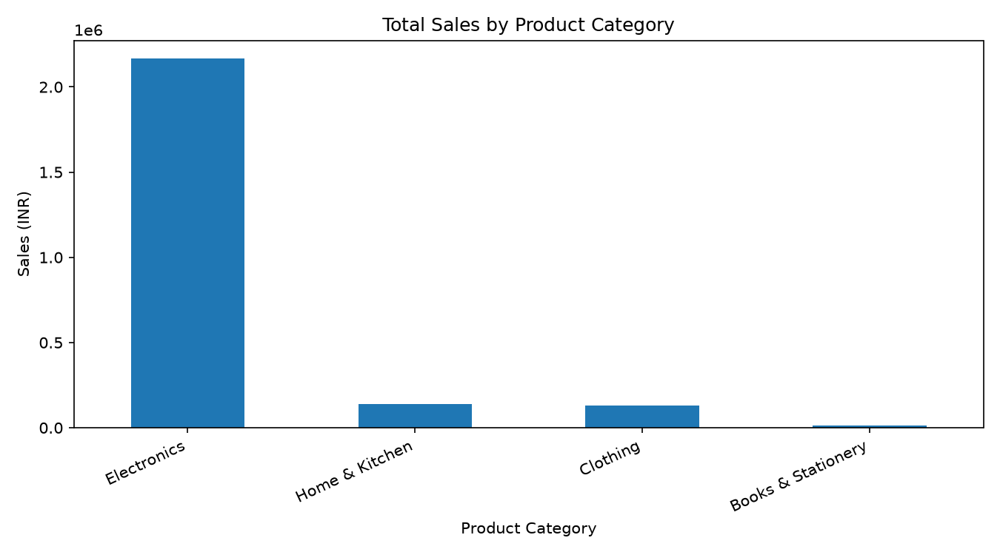
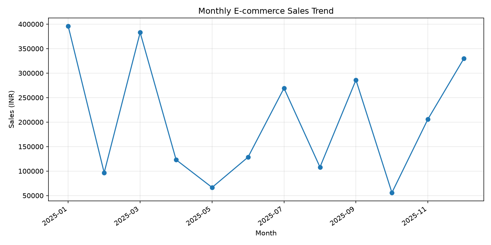
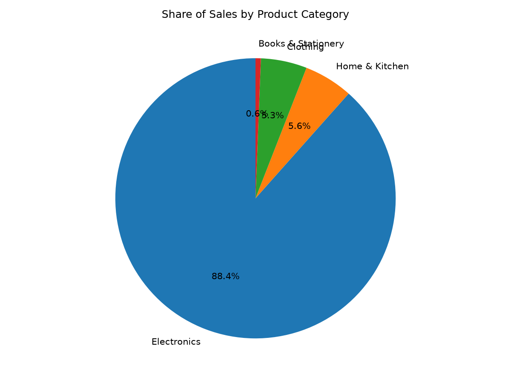

# E-commerce Sales Analysis Report

## 1. Project overview
This project analyzes a sample e-commerce dataset to compare product categories
and understand monthly sales trends.

## 2. Dataset
- Valid records: **100**
- Dataset columns: **5**
- Unique orders: **100**
- Date range: **2025-01-05 to 2025-12-26**

## 3. Key metrics
| Metric | Result |
|---|---:|
| Total revenue | INR 2,448,430.19 |
| Number of orders | 100 |
| Units sold | 287 |
| Average order value | INR 24,484.30 |

## 4. Sales by category
| Category           |      Sales (INR) |
|:-------------------|-----------------:|
| Electronics        |      2.16522e+06 |
| Home & Kitchen     | 138100           |
| Clothing           | 130098           |
| Books & Stationery |  15014           |

## 5. Monthly sales
| Month   |   Sales (INR) |
|:--------|--------------:|
| 2025-01 |      395915   |
| 2025-02 |       96643.2 |
| 2025-03 |      383042   |
| 2025-04 |      123044   |
| 2025-05 |       66575.5 |
| 2025-06 |      128445   |
| 2025-07 |      269223   |
| 2025-08 |      108077   |
| 2025-09 |      285951   |
| 2025-10 |       55929.4 |
| 2025-11 |      205923   |
| 2025-12 |      329662   |

## 6. Visualizations
### Bar chart - sales by category

### Line chart - monthly sales trend

### Pie chart - share by category

## 7. Insights
- **Electronics** is the highest-revenue category in this sample.
- **2025-01** is the strongest sales month.
- **2025-10** is the lowest sales month.
- The category charts compare revenue shares, while the line chart shows
  month-to-month revenue changes.

## 8. Limitations
This is synthetic practice data, not real company information. Customer,
discount, return, and cost data would be needed for deeper business conclusions.

## 9. Conclusion
The project demonstrates loading, validation, cleaning, analysis, visualization,
and communicating findings in a written report.
